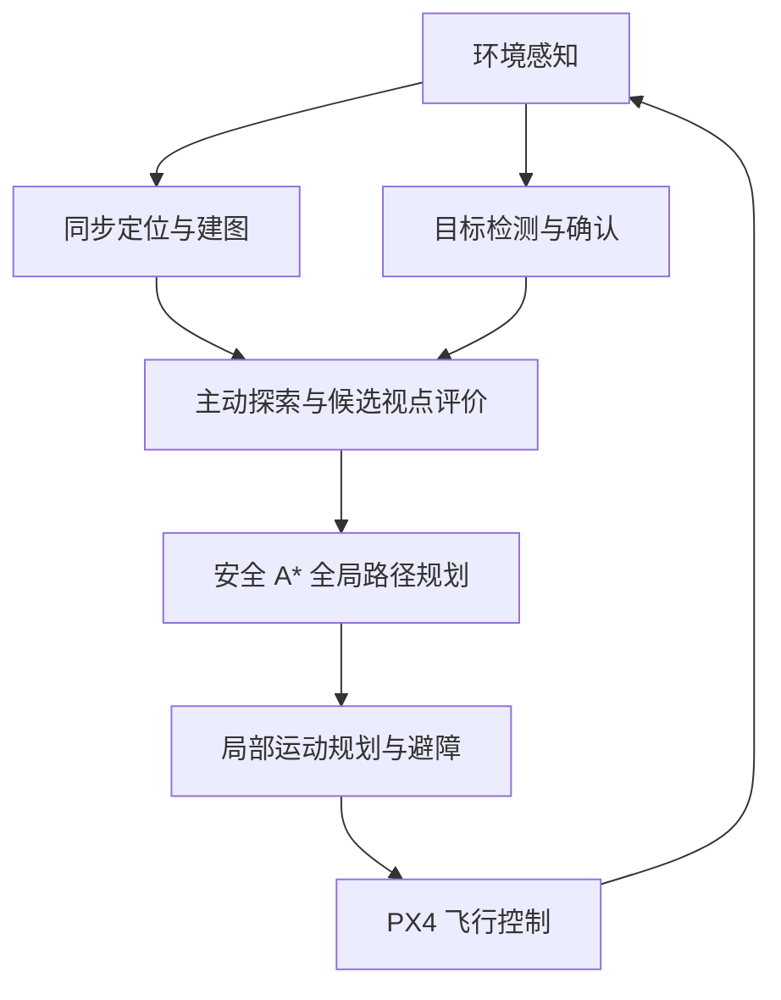
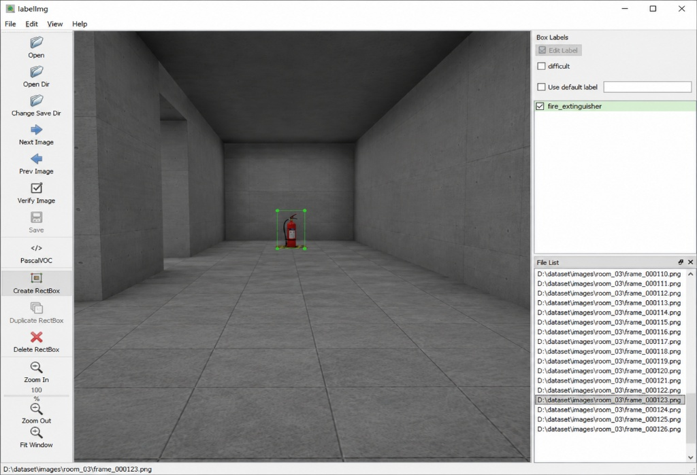
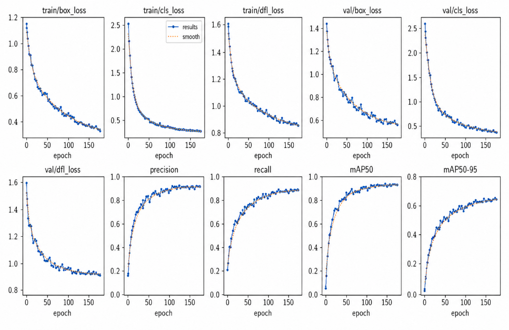
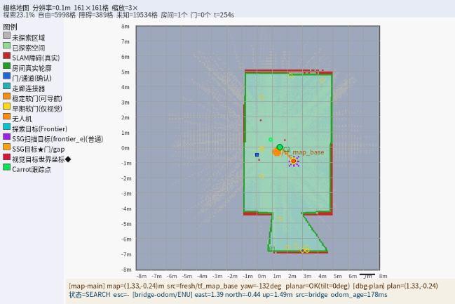
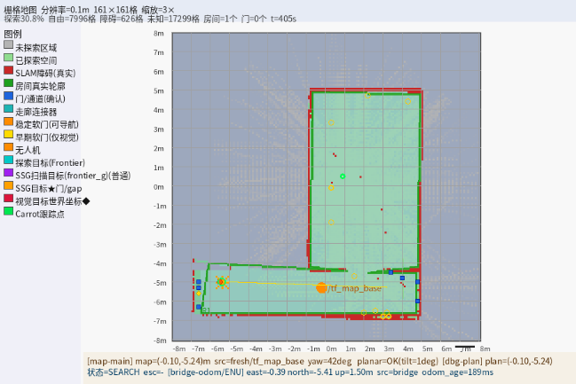
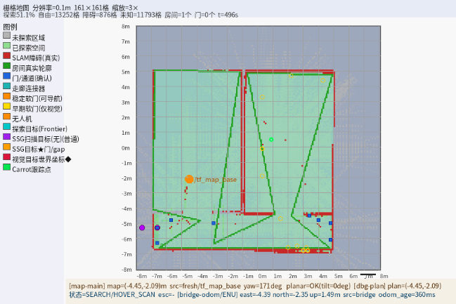
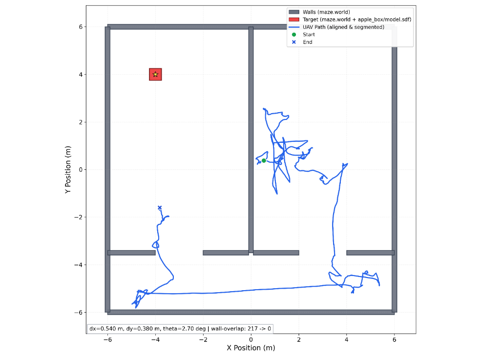

# 基于深度学习的室内自主目标搜索无人机控制系统

> 面向目标位置与环境结构均未知的室内场景，研究如何在保障飞行安全的前提下完成自主搜索，并提高探索效率。

- **项目类别：** 吉林大学省级大学生创新创业训练计划项目（已结题）
- **所属学院：** 吉林大学电子科学与工程学院
- **项目成果：** 计算机软件著作权（登记号：2026SR0599868）
- **开发平台：** ROS 2 Humble、PX4、Gazebo
- **当前阶段：** 仿真系统开发与功能性验证

## 一、项目简介

本项目面向目标位置未知、环境结构未知的室内无人机自主搜索任务。传统固定航迹巡航难以充分利用已探索的环境信息动态决定后续搜索区域，容易产生重复搜索与局部打转；同时，常规路径规划方法在门洞、走廊等狭窄区域容易出现路径贴墙、潜在碰撞及规划路径难以执行等问题。

围绕上述场景，本项目重点研究两个核心问题：

- **下一步去哪：** 如何综合环境建图信息、目标概率及历史探索记录，自主选择具有较高搜索价值的候选视点，减少重复探索与无效巡航。
- **如何安全到达：** 如何在复杂室内环境中综合考虑障碍物分布、飞行安全约束及路径代价，提高规划路径的安全性与可执行性。

针对上述问题，项目融合深度学习目标检测、同步定位与建图（SLAM）、主动视点选择、安全路径规划及局部运动控制等技术，构建室内无人机自主目标搜索系统，实现感知、决策、规划与控制的闭环协同。

## 二、系统总体方案

系统以 ROS 2 为通信与功能集成框架，以 PX4 为飞行控制平台，依托 Gazebo 开展仿真验证。通过环境感知、地图更新、目标检测、主动选点、路径规划和局部控制形成自主搜索闭环。



上述流程为系统总体功能关系示意，不代表实际 ROS 2 话题连接拓扑。

## 三、核心研究内容

### 1. 基于深度学习的目标检测

以灭火器为目标检测实验对象，在 Gazebo 室内仿真环境中采集不同距离、不同背景下的 RGB 图像，同时保留空房间、空走廊及墙角等不包含目标的负样本，以增强数据场景的多样性。

使用 LabelImg 对目标进行人工框选标注，按照 YOLO 数据格式整理数据集，并划分训练集、验证集和测试集。

<p align="center">
  
</p>
<p align="center">目标检测数据集构建与人工标注</p>

采用 YOLO11n 预训练权重（`yolo11n.pt`）进行迁移训练，获得最优模型权重 `best.pt`。通过损失函数、精确率、召回率、mAP50 和 mAP50-95 等指标分析模型训练效果，并使用验证集开展推理验证。

<p align="center">
  
</p>
<p align="center">目标检测模型训练过程与评价指标</p>

### 2. 基于 SSG 的主动探索策略

传统路径规划主要解决无人机“如何到达指定位置”的问题，却无法直接解决未知环境中“下一步应该去哪里”的问题。为此，项目设计了“停—扫—走”（SSG）主动探索策略，将搜索任务由预设路线巡航转化为依据实时环境信息进行的自主决策过程。

具体流程如下：

1. **停：** 到达当前搜索视点后悬停。
2. **扫：** 扫描周围环境，更新 SLAM 地图及目标概率信息。
3. **选点：** 若尚未发现目标，则生成候选视点并进行综合评价。
4. **走：** 通过安全 A* 算法规划前往下一视点的路径，并执行飞行控制。
5. 到达新视点后继续悬停扫描，形成“建图—选点—规划—执行”的探索闭环。

候选视点主要来源于未知区域边界、门洞区域、需要补充扫描的区域以及具有目标概率信息的区域。

视点评价综合考虑以下因素：

| 评价因素 | 作用 |
| --- | --- |
| 信息增益 | 优先探索能够获取更多未知环境信息的区域 |
| 目标概率 | 优先搜索更可能存在目标的区域 |
| 路径代价 | 考虑到达候选视点所需的移动代价 |
| 安全风险 | 降低进入高风险区域的倾向 |
| 重访惩罚 | 减少对已访问区域的重复搜索与局部徘徊 |

### 3. 面向室内狭窄环境的安全 A* 路径规划

针对传统 A* 算法在室内无人机搜索场景中可能出现的贴墙、斜穿墙角及路径难以执行等问题，在路径规划过程中引入多种安全约束。

| 改进措施 | 设计目的 |
| --- | --- |
| 障碍物膨胀 | 为无人机与障碍物之间预留安全空间 |
| 距离场安全代价 | 降低规划路径过于接近墙体的倾向 |
| 禁止斜穿墙角 | 避免栅格对角移动造成的潜在碰撞 |
| 起终点吸附 | 在必要时将规划起终点调整至合适的可通行栅格 |
| 周期性重规划 | 根据地图更新重新计算路径，提高对未知环境的适应能力 |

通过主动视点选择与安全 A* 路径规划的结合，分别解决“下一步去哪”与“如何安全到达”的问题。

### 4. 局部控制与安全监测

系统将全局路径规划与局部运动控制相结合，设置人工势场（APF）、局部模型预测控制（MPC）、目标确认、安全监测以及 PX4 与 SLAM 数据桥接等功能模块，为搜索过程中的避障、路径执行与状态监测提供支持。

## 四、仿真验证

在包含房间、墙体、门洞和走廊的室内仿真环境中，开展目标检测、环境建图、主动探索及路径规划等功能的联合调试。

### 1. 自主探索与地图更新

以下为同一探索过程在不同阶段的地图记录，展示无人机由初始房间逐步向走廊及相邻房间扩展探索范围的过程。

<p align="center">
  
  
  
</p>

<p align="center">室内主动探索过程中不同阶段的地图与搜索视点</p>

### 2. 飞行轨迹与路径执行

<p align="center">
  
</p>
<p align="center">室内仿真场景中的无人机飞行轨迹记录</p>

现阶段主要完成系统功能性验证，以上记录用于展示主动探索与路径执行过程，不作为搜索成功率、效率提升幅度或安全性能的统计性结论。

### 3. 系统实现效果

基于 ROS 2 与 PX4 完成系统实现及多功能模块联合调试，在未知室内仿真环境中构建了“感知—建图—选点—规划—执行—再感知”的自主搜索闭环。

现阶段主要实现以下功能：

- 根据实时环境感知信息持续更新室内栅格地图；
- 综合候选视点的搜索价值与通行代价，动态选择后续搜索区域；
- 结合安全 A* 路径规划与局部运动控制，实现房间、走廊及门洞等区域的自主探索；
- 完成深度学习目标检测与自主搜索任务决策的集成；
- 针对重复探索、局部打转、路径贴墙及狭窄区域通行困难等问题开展针对性优化。

目前已完成多房间室内环境下的自主探索与系统功能性验证，搜索效率、安全性能及场景泛化能力仍有待通过系统性的量化实验进一步评估。

## 五、代码结构

本仓库主要收录软件控制系统的核心代码、消息接口、建图配置及启动脚本。

```text
.
├── config/
│   └── slam_toolbox_params.yaml    # 建图参数配置
├── msg/
│   ├── ApfCommand.msg              # 人工势场控制消息
│   ├── LocalCommand.msg            # 局部控制消息
│   └── SearchPath.msg              # 搜索路径消息
├── src/
│   ├── apf_node.py                 # 人工势场节点
│   ├── global_planner_node.py      # 全局路径规划节点
│   ├── local_mpc_node.py           # 局部模型预测控制节点
│   ├── px4_slam_bridge_node.py     # PX4 与 SLAM 数据桥接节点
│   ├── safety_monitor.py           # 安全监测模块
│   ├── target_confirmation.py      # 目标确认模块
│   └── target_search_node.py       # 自主目标搜索节点
├── assets/                         # 项目实验与仿真展示图片
├── CMakeLists.txt                  # 编译配置
├── package.xml                     # ROS 2 功能包与依赖声明
├── start_indoor_search.sh          # 系统启动与运行管理脚本
└── README.md                       # 项目说明
```

## 六、开发环境与运行说明

系统主要依赖以下软件及工具：

| 功能 | 软件或技术 |
| --- | --- |
| 操作系统 | Linux |
| 机器人通信与功能集成 | ROS 2 Humble |
| 飞行控制与软件在环仿真 | PX4、Gazebo Classic |
| 同步定位与建图 | SLAM Toolbox |
| 视觉检测与图像处理 | YOLO11n、Ultralytics、OpenCV |
| 路径规划与运动控制 | A*、APF、MPC |
| 工程运行与调试 | Python、CMake、colcon、tmux |

ROS 2 功能包名称为 `indoor_search`，具体依赖见 [`package.xml`](package.xml)。

仓库提供的 [`start_indoor_search.sh`](start_indoor_search.sh) 为原开发环境中的系统启动与管理脚本，支持以下操作：

| 参数 | 功能 |
| --- | --- |
| `full` | 完整启动，包含编译 |
| `no-compile` | 跳过编译，快速启动 |
| `stop` | 停止系统组件 |
| `status` | 查看运行状态 |
| `health` | 检查坐标变换、话题及建图状态 |
| `logs` | 查看最新日志路径 |
| `attach` | 进入 tmux 会话 |

启动脚本依赖原有 PX4 工作空间、ROS 2 功能包及通信组件，并包含 `/home/ubuntu/PX4-Autopilot` 等固定路径。使用前需要根据实际环境调整路径、安装外部依赖，并补齐所需仿真场景和模型权重等资源。

当前仓库主要用于核心代码及科研成果展示，尚未整理为可直接在全新环境中一键复现的完整工程。

## 七、项目成果与个人贡献

### 项目成果

| 项目 | 内容 |
| --- | --- |
| 大创项目名称 | 基于深度学习的室内自主目标搜索无人机控制系统设计 |
| 项目类别 | 省级大学生创新创业训练计划项目 |
| 项目状态 | 已结题 |
| 软件名称 | 基于深度学习的室内自主目标搜索无人机控制系统 V1.0 |
| 软件著作权登记号 | 2026SR0599868 |
| 著作权人 | 吉林大学 |
| 登记日期 | 2026 年 5 月 12 日 |

### 个人贡献

本人为项目第一负责人，主要负责项目总体技术方案设计、系统架构构建与核心代码实现，承担从算法设计、工程实现、系统联调到仿真验证及项目结题的主要工作。

具体包括：

- **系统总体设计：** 构建目标检测、同步定位与建图、主动探索、路径规划及飞行控制相结合的系统架构。
- **视觉感知：** 完成室内目标检测数据集构建、YOLO11n 模型迁移训练及检测模块的系统接入。
- **主动探索：** 设计多因素候选视点评价机制与 SSG 主动探索策略。
- **路径规划：** 完成面向室内狭窄环境的安全 A* 路径规划算法设计与实现。
- **工程实现：** 负责主要核心代码开发、ROS 2 与 PX4 系统集成、多模块联合调试及运行问题定位。
- **实验验证：** 负责仿真实验、系统迭代优化、项目成果整理及结题工作。

## 八、现有不足与后续研究

目前项目仍存在以下不足：

- 以仿真验证为主，尚未完成真机部署；
- 目标检测数据集的场景覆盖仍有待扩展；
- 以功能性验证为主，尚缺少系统性的统计与对比实验。

后续研究可围绕多场景泛化验证、真机部署及仿真到现实迁移展开，并建立更加完善的量化评价体系：

| 评价维度 | 评价指标 |
| --- | --- |
| 任务完成能力 | 搜索成功率、搜索时间 |
| 搜索效率 | 探索覆盖率、重复访问率 |
| 安全性能 | 最小障碍距离 |
| 场景泛化能力 | 新场景下各项指标的保持程度 |

## 九、版权说明

本项目软件著作权人为吉林大学。项目代码及相关成果的使用、复制、修改与再分发应遵循相应权利人的授权及适用许可条件。第三方组件遵循各自的许可协议。本说明文档不单独授予软件使用或再分发许可。
